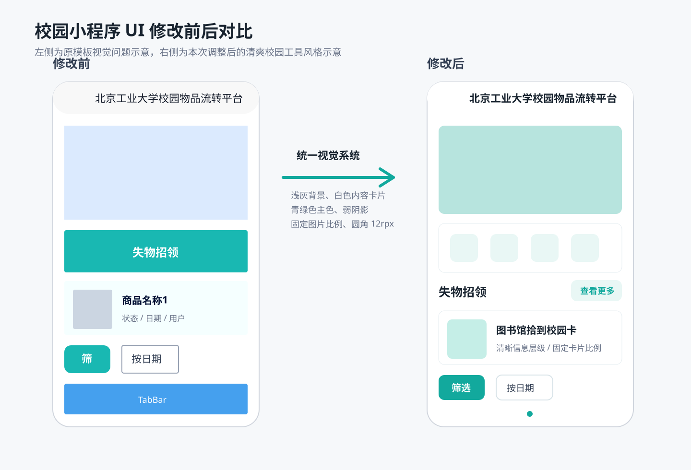

# 小程序 UI 修改前后对比文档

生成时间：2026-05-23

## 对比示意图

## 本次 UI 调整范围

本次先做“清爽校园工具”方向的基础 UI 大改，不改业务流程，不改数据库结构。重点覆盖微信小程序产物 `mp-weixin`，同时同步源码目录 `python7i67w282/api/templates/front/front`，避免后续重新编译时丢失样式。

涉及页面：

- 首页：首页轮播、快捷菜单、AI 助手入口、失物招领、二手流转、校园动态。
- 列表页：失物招领、二手流转、校园动态。
- 详情页：失物详情、二手详情、新闻详情、评论区、底部操作栏。
- 个人中心：用户信息卡片、认证标识、我的服务入口。
- 表单页：个人资料、学生证上传、输入框和按钮。

## 修改前主要问题

| 页面 | 修改前表现 | 影响 |
| --- | --- | --- |
| 首页 | 分区标题使用旧模板底图，按钮和卡片混用渐变 | 模板感明显，校园平台质感不足 |
| 列表页 | 搜索、筛选、分类栏和卡片视觉不统一 | 页面显得拥挤，分类容易抢占内容空间 |
| 二手分类 | 商品类型曾显示为 `商品类型1-8` | 不符合真实校园二手场景 |
| 详情页 | 字段行边框粗、图片满宽无间距、评论区阴影重 | 信息层级不清晰 |
| 个人中心 | 头像、认证、服务入口布局偏模板化 | 已认证状态不够自然 |
| 全局 | TabBar 蓝底白字，按钮大量蓝绿渐变 | 和清爽校园工具风格不一致 |

## 修改后效果

| 模块 | 修改后设计 | 关键变化 |
| --- | --- | --- |
| 全局框架 | 浅灰页面背景 + 白色内容卡片 | 降低视觉噪音，页面更像校园服务工具 |
| 主色 | 使用青绿色 `#12A99D` | 按钮、选中态、图标统一 |
| 卡片 | 12rpx 圆角 + 轻阴影 + 细边框 | 保持清爽，不再像模板大渐变 |
| 首页标题 | 去掉旧标题底图 | 分区标题改为深色文字，右侧轻按钮 |
| 首页轮播 | 固定圆角横幅 | 图片更像内容入口 |
| 列表页 | 搜索框、筛选按钮、分类栏统一 | 分类固定宽度，卡片稳定排列 |
| 详情页 | 图片、字段、评论、底部操作栏统一 | 字段可读性提高，评论更轻 |
| 个人中心 | 白色用户卡片 + 服务卡片 | 认证图标保留，整体更干净 |

## 已修改文件

- `mp-weixin/app.json`
- `mp-weixin/app.wxss`
- `python7i67w282/api/templates/front/front/pages.json`
- `python7i67w282/api/templates/front/front/App.vue`

## 数据同步状态

当前 MySQL 已完成演示数据覆盖：

- 管理员账号保留：`users_admin = 1`
- 普通用户：8 个
- 失物招领：8 条
- 二手流转：8 条
- 校园动态：8 条
- 商品类型：笔记本电脑、衣架挂钩、教材资料、台灯、耳机、自行车、键盘、计算器
- 旧模板数据检查：`账号1`、`姓名1`、`商品名称1`、`商品类型1` 均为 0

## 后续可继续细化

下一步可以继续做更深入的页面级重构：

- 首页改成更完整的信息仪表盘布局。
- 二手和失物列表增加状态标签、价格/地点重点展示。
- 详情页重写字段结构，减少生成器内联样式依赖。
- 个人中心增加认证状态卡片、我的发布、我的收藏统计。
- 登录、注册、发布表单做统一组件化。
